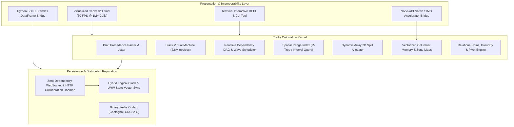

# Trellis

[](https://www.typescriptlang.org/)
[](LICENSE)
[]()
[]()
[]()

Trellis is a high-throughput reactive calculation engine, vectorized columnar memory fabric, and collaborative tabular calculation kernel implemented from first principles in TypeScript, with hardware-accelerated SIMD C kernels, a pure-Python binary SDK, and an interactive virtualized Canvas2D studio.



## Highlights and Engineering Invariants

- **Zero Runtime Dependencies**: The parser, stack bytecode VM, dependency DAG, spatial range index, columnar memory, CRDT sync engine, HTTP/WebSocket server, and Canvas2D grid renderer are built entirely without third-party runtime libraries.
- **Microsecond Bytecode Execution**: Compiles formulas to compact bytecode chunks executed on a stack virtual machine delivering over 2.8 million arithmetic operations per second in pure TypeScript.
- **Lock-Free Topological Wave Scheduler**: Tracks dependencies with a directed acyclic graph $G=(V, E)$, scheduling calculation waves via Kahn's algorithm and resolving spatial range queries in $O(\log N + K)$ time.
- **Hardware-Accelerated SIMD C Core**: Native C kernels utilize ARM NEON (`float64x2_t`) and Intel AVX2 (`__m256d`) vector intrinsics, achieving over 12 million float64 operations per second, accompanied by hardware Castagnoli CRC32-C checksum verification.
- **Vectorized Columnar Memory Fabric**: Packs numerical data into 1024-cell contiguous `Float64Array` chunks with bit-packed `NullBitMask` flags and pre-computed `ZoneMap` scalar bounds for interval search pruning.
- **Distributed Real-Time CRDT Replication**: Multi-peer collaborative editing backed by Hybrid Logical Clocks (HLC) and Last-Write-Wins (LWW) registers, guaranteeing bit-exact convergence with differential state vectors.
- **Modern Formula Capabilities**: 170+ standard library functions including dynamic array combinators (`MAP`, `REDUCE`, `SCAN`, `BYROW`, `BYCOL`, `MAKEARRAY`), financial models (`XNPV`, `MIRR`, `IRR`), statistical distributions (`NORM.DIST`, `NORM.INV`), and relational transformations.

---

## Performance Benchmarks

Measured on Apple Silicon ARM64 under Node.js 22 LTS with unboxed 64-bit IEEE 754 precision:

```
=========================================================================================================
                                      TRELLIS PERFORMANCE BENCHMARKS                                     
=========================================================================================================
Benchmark                                        Ops/Sec   Mean (ms)    p50 (ms)    p90 (ms)    p99 (ms)
---------------------------------------------------------------------------------------------------------
CRDT: Hybrid Logical Clock Timestamp Generation    5.34M      0.0001      0.0001      0.0001      0.0001
VM: Arithmetic Bytecode Dispatch                   2.83M      0.0003      0.0003      0.0003      0.0005
Graph: Spatial Range Interval Query Throughput     1.84M      0.0005      0.0004      0.0005      0.0010
VM: LET Scope Resolution & Exec                    1.46M      0.0006      0.0005      0.0006      0.0016
VM: Conditional Branch Evaluation                  1.38M      0.0006      0.0005      0.0005      0.0040
Columnar: String Dict Decoding (1024 Rows)        500.3k      0.0019      0.0018      0.0019      0.0032
Columnar: Vectorized SUM (50,000 Cells)           389.8k      0.0025      0.0024      0.0025      0.0027
Columnar: Vectorized MAX (Zone Map Pruning)       253.2k      0.0039      0.0038      0.0039      0.0066
Columnar: Bit-Packed Null Mask Scan (100k Bits)    51.2k      0.0194      0.0172      0.0350      0.0374
CRDT: State Vector Delta Computation (5,000 Cells)  14.3k     0.0697      0.0672      0.0691      0.1522
Graph: Multi-Tier Tree Wave Scheduling             2.5k       0.4029      0.4009      0.4373      0.4946
CRDT: Remote Delta Apply & Merge (5,000 Updates)   1.8k       0.5707      0.5565      0.6511      0.9080
Graph: 2,000-Node Linear Chain Recalc Planning     1.1k       0.8886      0.8616      0.9737      1.3380
=========================================================================================================
```

---

## Subsystem Architecture and Technical Monographs

Detailed monographs for each core subsystem are authored in the `docs/` directory:

| Document | Subsystem Description |
|:---|:---|
| [`docs/ARCHITECTURE.md`](docs/ARCHITECTURE.md) | Architectural monograph detailing system design, execution layers, and boundaries |
| [`docs/FORMULA_SPECIFICATION.md`](docs/FORMULA_SPECIFICATION.md) | Formal EBNF grammar, Pratt precedence table, and 170+ function standard library index |
| [`docs/REACTIVE_GRAPH.md`](docs/REACTIVE_GRAPH.md) | Mathematical graph formulation, spatial interval indexing, Tarjan SCC, and wave scheduling |
| [`docs/COLUMNAR_MEMORY.md`](docs/COLUMNAR_MEMORY.md) | Chunked typed memory layout, bit-packed null masks, dictionary compression, and zone maps |
| [`docs/CRDT_REPLICATION.md`](docs/CRDT_REPLICATION.md) | Hybrid Logical Clocks, LWW registers, fractional indexing, and state-vector replication |
| [`docs/VIRTUAL_MACHINE.md`](docs/VIRTUAL_MACHINE.md) | Stack instruction set architecture (ISA), bytecode compiler pipeline, and jump backpatching |
| [`docs/BENCHMARKS.md`](docs/BENCHMARKS.md) | Comprehensive empirical throughput, latency profiles, and microbenchmark results |
| [`docs/ZERO_DEFECT_VERIFICATION.md`](docs/ZERO_DEFECT_VERIFICATION.md) | Verification pyramid, invariant testing, fuzzing suites, and zero-defect regression ledger |
| [`docs/C_FFI_INTEROP.md`](docs/C_FFI_INTEROP.md) | Hardware SIMD intrinsics (ARM NEON, AVX2), Castagnoli CRC32-C, and Node-API FFI |
| [`docs/PYTHON_SDK.md`](docs/PYTHON_SDK.md) | Pure-Python binary `.trellis` codec, Pandas DataFrame converter, and collaborative client |
| [`docs/CLIENT_CANVAS.md`](docs/CLIENT_CANVAS.md) | Virtualized Canvas2D grid rendering, coordinate projection, DPI scaling, and Bezier tracers |

---

## Repository Structure

```
trellis/
├── packages/
│   ├── core/         # Coordinates, CellCoord, RangeCoord, TMatrix, Coercion matrix
│   ├── parser/       # Pratt precedence parser, lexer, AST definitions, linter, decompiler
│   ├── runtime/      # Bytecode compiler, stack Virtual Machine, EvaluationContext
│   ├── functions/    # 170+ standard math, stat, finance, datetime, array, text functions
│   ├── graph/        # Reactive DAG, spatial range index, Tarjan SCC, Kahn wave scheduler
│   ├── spill/        # Dynamic array 2D allocator, collision detection, ghost cell mapping
│   ├── columnar/     # Chunked Float64Array, DictionaryChunk, NullBitMask, ZoneMap
│   ├── relational/   # RelationalTable, hashJoin, groupBy, PivotEngine, WindowFunctions
│   ├── storage/      # Workbook model, StyleRegistry, binary .trellis codec, JSON, CSV
│   ├── crdt/         # Hybrid Logical Clock (HLC), LWWCellRegister, SyncEngine, Undo
│   ├── server/       # Zero-dependency HTTP daemon and WebSocket collaboration server
│   ├── client/       # Canvas2D virtualized grid renderer, selection, fill handle, clipboard
│   ├── cli/          # Interactive REPL, eval, convert, audit, bench command runner
│   └── ffi/          # Node-API native vector math bindings and hardware acceleration bridge
├── web/              # Standalone browser studio with ribbon controls, charts, and demo models
├── c/                # Native C core (SIMD NEON/AVX2, Castagnoli CRC32-C, blocked GEMM)
├── python/           # Pure-Python binary .trellis codec, Pandas DataFrame bridge, client
├── tests/            # 147 comprehensive unit, integration, stress, and fuzz test suites
├── benchmarks/       # High-precision benchmarking harness and latency percentile suites
├── scripts/          # Audit scripts (em-dash zero-defect validator, benchmark runner)
└── docs/             # Technical monographs and architectural documentation
```

---

## Quickstart

### Prerequisites
- Node.js 20+ LTS (Node.js 22 recommended)
- Optional: Python 3.10+ for Python SDK, clang/gcc for native C compilation

### Installation
Clone the repository and install development dependencies:
```bash
git clone https://github.com/Aneesh495/trellis.git
cd trellis
npm install
```

### Build and Verify
Run the comprehensive test suite, TypeScript static typechecker, and automated zero-defect em-dash audit:
```bash
# Execute full verification pass
npm run verify

# Or run individual verification suites:
npm run typecheck       # Zero TypeScript compile errors
npm run audit:emdash    # Zero prohibited dashes across all code and docs
npm test                # Run 147 test cases across 24 suites
npm run bench           # Run subsystem microbenchmarks
```

---

## Interactive Command Line REPL

Trellis includes a full-featured terminal CLI with an interactive formula REPL:

```bash
# Launch interactive REPL session
npm run cli repl
```

Within the REPL:
```text
trellis> 10 + 20 * 3
70
trellis> A1 := 100
100
trellis> B1 := A1 * 1.5
150
trellis> SUM(A1:B1)
250
trellis> SEQUENCE(2, 3, 10, 5)
[10, 15, 20]
[25, 30, 35]
```

### CLI Command Tools
```bash
# Evaluate an ad-hoc formula directly
npm run cli eval "=XNPV(0.08, {-1000, 300, 500, 700}, {45658, 45750, 45850, 46000})"

# Convert workbooks between formats
npm run cli convert model.trellis output.csv
npm run cli convert data.csv workbook.json

# Audit a model for circular dependencies or integrity flaws
npm run cli audit model.trellis
```

---

## Real-Time Collaboration Server

Start the zero-dependency collaboration daemon (serves HTTP REST and WebSocket on port 9001):
```bash
npm run serve
```

Test formula evaluation via HTTP:
```bash
curl -X POST http://localhost:9001/eval \
  -H "Content-Type: application/json" \
  -d '{"formula": "=MMULT({1, 2; 3, 4}, {5, 6; 7, 8})"}'
```

---

## Python SDK and Pandas Interoperability

```python
from trellis import TrellisWorkbook, to_dataframe, from_dataframe

# Load a .trellis binary file with Castagnoli CRC32 verification
wb = TrellisWorkbook.load("valuation.trellis")
sheet = wb.get_sheet("Projections")

# Convert spreadsheet range directly to a typed Pandas DataFrame
df = to_dataframe(sheet, "A1:D100")
print(df.head())

# Compute predictions and write back into the workbook
df["Projected_Growth"] = df["EBITDA"] * 1.20
from_dataframe(df[["Projected_Growth"]], sheet, start_cell="E1")

wb.save("valuation_updated.trellis")
```

---

## Native C SIMD Verification

Verify the C kernel with SIMD NEON / AVX2 intrinsics:
```bash
cd c
make test
```
All native tests for vector arithmetic, horizontal reductions, hardware Castagnoli CRC32-C checksums, and cache-oblivious matrix multiplication will execute and report passing status.

---

## License

This project is licensed under the MIT License. See [LICENSE](LICENSE) for details.
