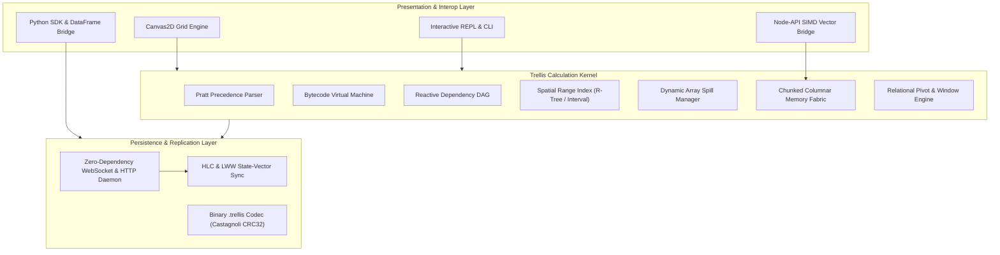

# Architectural Monograph: Trellis Core Architecture

Trellis is a reactive calculation engine, vectorized columnar memory fabric, and collaborative tabular calculation kernel implemented from first principles. This document provides a formal exposition of the system architecture, mathematical formulations, subsystem boundaries, and execution models.

## 1. Design Principles

1. Zero External Runtime Dependencies: The entire calculation engine, parser, virtual machine, dependency graph, server daemon, and client canvas are written without third-party runtime packages.
2. Vectorized Columnar Memory: Numerical data is packed into contiguous 64-bit IEEE 754 floating-point buffers with bit-packed null masks, enabling hardware cache-line alignment and SIMD throughput.
3. Lock-Free Reactive Recalculation: Directed acyclic graph propagation evaluates mutated cells in topological calculation waves derived via Kahn's algorithm, eliminating redundant recomputations.
4. Strong Eventual Consistency: Distributed collaborative edits are synchronized using Hybrid Logical Clocks (HLC) and Last-Write-Wins (LWW) conflict-free registers.

## 2. Subsystem Decomposition

### 2.1 Coordinate Geometry and Type System (@trellis/core)
Spreadsheet addresses map bidirectionally between column-row coordinates and string identifiers:
- `CellCoord`: Represents an individual cell `(sheet, row, col)`.
- `RangeCoord`: Represents a rectangular bounding box `(startRow, startCol, endRow, endCol)`.
- `TMatrix`: Two-dimensional immutable matrix primitive supporting slicing, transposition, dot products, and scalar broadcasting.
- `Coercion Matrix`: Strict coercion rules matching IEEE standards for numerical, boolean, string, date serials, and error propagation.

### 2.2 Pratt Lexer, Parser, and AST (@trellis/parser)
Mathematical and relational formulas are tokenized via deterministic finite-state scanner and parsed using Top-Down Operator Precedence (Pratt parsing):
- Binding powers from lowest to highest: comparison (`=`, `<`, `>`), concatenation (`&`), addition/subtraction (`+`, `-`), multiplication/division (`*`, `/`), exponentiation (`^`), and unary prefix/postfix operators.
- Supports first-class `LET(name, value, ...)` lexical scoping and `LAMBDA(param1, ..., body)` closures.
- Roundtrip AST decompilation reproducing identical canonical formula representations.

### 2.3 Stack Virtual Machine and Instruction Set (@trellis/runtime)
Formulas compile to compact bytecode chunks executed on a stack virtual machine:
- Opcodes include `OP_CONSTANT`, `OP_LOAD_CELL`, `OP_LOAD_RANGE`, `OP_ADD`, `OP_CALL_FUNC`, `OP_JUMP_IF_FALSE`, `OP_RETURN`.
- Short-circuit conditional branching prevents evaluation of unreached branches (e.g. division by zero in unreached branch of `IF`).
- Scope frames resolve local lexical bindings introduced by `LET` and `LAMBDA` expressions.

### 2.4 Dependency DAG and Spatial Wave Scheduler (@trellis/graph)
Reactive state is orchestrated by a directed graph $G = (V, E)$:
- Vertex $v \in V$: Represents a formula cell or data coordinate.
- Edge $(u, v) \in E$: Directed edge indicating $v$ depends on $u$.
- Spatial Range Index: Uses multi-dimensional interval trees to map rectangular range queries (e.g. `SUM(A1:B100)`) to cell coordinates in $O(\log n + k)$ time.
- Tarjan Strongly Connected Components (SCC): Detects circular dependencies in linear time $O(V + E)$ and marks cycle paths with `#REF!`.
- Topological Wave Scheduler: Partitions dirty cells into independent evaluation waves using in-degree reduction, enabling parallel wave dispatch.
- Iterative Relaxation Solver: When iterative calculation is enabled, cycles are solved iteratively until absolute convergence tolerance $\epsilon$ is reached.

### 2.5 Dynamic Array Spill Manager (@trellis/spill)
Dynamic arrays allocate rectangular spill footprints from a formula root:
- Collision Detection: Inspects target bounding boxes to ensure non-blank cells are not overwritten, raising `#SPILL!` on obstruction.
- Ghost Cell Resolution: Automatically resolves reads on child cells inside the spill footprint to the corresponding element of the parent matrix.
- Obstruction Clearance: Tracks blocked coordinates and immediately recalculates the root when an obstruction is cleared.

### 2.6 Vectorized Columnar Memory Fabric (@trellis/columnar)
Tabular data is partitioned into chunked columnar vectors (chunk size: 1024 cells):
- `Float64Chunk`: Contiguous `Float64Array` backing numerical data with hardware alignment.
- `DictionaryChunk`: Integer dictionary encoding for low-cardinality categorical strings.
- `NullBitMask`: 64-bit word bitmasks tracking presence/absence with bitwise popcount operations.
- `ZoneMap`: Tracks minimum, maximum, count, and sum per chunk, enabling immediate interval pruning during scans.

### 2.7 Relational and Analytical Engine (@trellis/relational)
Transforms tabular cell ranges into relational relations:
- `RelationalTable`: Column-oriented relational projection and filtering.
- `hashJoin`: Inner, left, and full outer joins using linear-time hash tables.
- `groupBy`: Categorical hashing with multiple simultaneous aggregations (SUM, COUNT, AVERAGE, MIN, MAX).
- `PivotEngine`: Multi-dimensional pivot grids with cross-tabulation and grand totals.
- `WindowFunctions`: Analytical partitioning with moving averages, cumulative sums, and competition rankings.

### 2.8 Distributed CRDT Collaboration (@trellis/crdt, @trellis/server)
Multi-peer real-time synchronization:
- `Hybrid Logical Clock (HLC)`: Combines physical wall-clock time with logical sequence counters to achieve strict monotonic causality across distributed peers.
- `LWW Register`: Last-Write-Wins cell register where ties are broken deterministically by client identifiers.
- `SyncEngine`: Computes minimal state-vector delta differentials, synchronizing divergent peers to exact bit-for-bit convergence.
- Zero-Dependency Server: Native Node.js HTTP and WebSocket daemon managing real-time peer broadcasts and session snapshots.

### 2.9 Hardware Acceleration and Interop (c/, @trellis/ffi, python/)
- C Kernel: Vectorized SIMD mathematics using ARM NEON and AVX2 intrinsics, cache-oblivious matrix multiplication, and hardware Castagnoli CRC32-C checksum engine.
- Node-API FFI: Zero-copy TypedArray buffer exchange between JavaScript V8 and native binaries.
- Python SDK: Pure-Python binary `.trellis` codec and Pandas DataFrame bidirectional converter.
