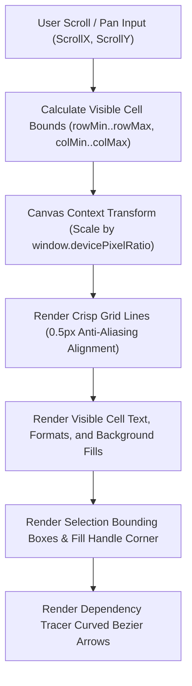

# Virtualized Canvas2D Grid Rendering Engine and Client Subsystem

This monograph details the geometry, viewport virtualization, coordinate mapping, and rendering architecture of the Trellis Canvas2D client.

## 1. Viewport Virtualization Geometry

Spreadsheet grids can contain millions of rows and columns. Instantiating DOM elements for millions of cells causes catastrophic layout recalculation and DOM node bloat.

Trellis implements a **Virtualized Canvas2D Renderer**:
- Single `<canvas>` element for the entire spreadsheet surface.
- Binary Search Coordinate Projection:
  - Given scroll offsets $(s_x, s_y)$ and viewport dimensions $(W, H)$, the engine performs binary search over cumulative row height and column width arrays.
  - Determines the exact visible row interval $[r_{start}, r_{end}]$ and column interval $[c_{start}, c_{end}]$.
  - Only visible cells (typically $\sim 50 \times 25 = 1250$ cells) are rendered per animation frame, achieving a locked 60 FPS regardless of grid size.

## 2. High-DPI and Retina Scaling Mechanics

To prevent fuzzy text and blurred lines on modern high-resolution displays:
- The canvas DOM buffer dimensions are scaled by `window.devicePixelRatio` (e.g. 2x or 3x):
  $$\text{canvas.width} = W \times \text{DPR}, \quad \text{canvas.height} = H \times \text{DPR}$$
- Canvas CSS style dimensions remain fixed at $(W, H)$.
- `ctx.scale(DPR, DPR)` is applied at the start of every render pass.
- Grid lines are positioned on half-pixel offsets (`x + 0.5`) to eliminate anti-aliased subpixel blur, ensuring crisp single-pixel grid borders.

## 3. Interactive Selection and Fill Handle Dragging

The `SelectionManager` coordinates keyboard and pointer interactions:
- Single Click: Selects primary anchor cell $(r, c)$.
- Shift + Click or Mouse Drag: Expands primary selection rectangle to $[r_{min}, r_{max}] \times [c_{min}, c_{max}]$.
- Fill Handle: A 6x6 pixel square positioned at the bottom-right corner of the active selection. Dragging the fill handle projects along the dominant axis (horizontal or vertical), triggering `ClipboardManager.shiftFormulaReferences()` to copy formulas with relative coordinate offsets.

## 4. Visual Dependency Arrow Tracing

To inspect formula relationships visually:
- `DependencyVisualizer` queries precedents and dependents from the calculation graph.
- Calculates cubic Bezier paths between cell centers:
  $$B(t) = (1-t)^3 P_0 + 3(1-t)^2 t P_1 + 3(1-t) t^2 P_2 + t^3 P_3$$
- Renders smooth directed arrows with directional arrowhead caps and distinct colors (blue for precedents, red for circular loops).

## 5. High-Resolution Charting Engine (web/src/charts.ts)

Trellis includes a built-in canvas charting engine:
- Line Charts: Time series trajectories with automatic numerical scale tick marks.
- Column / Bar Charts: Categorical grouped series with customizable colors.
- Tooltip Hit Testing: Interactive hover inspection identifying data points and category values.
