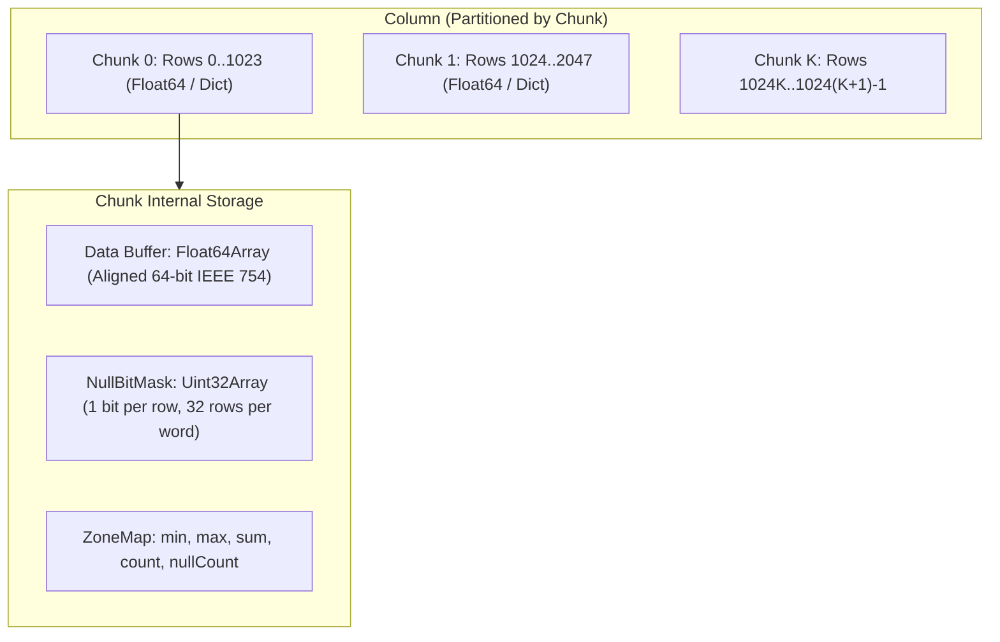

# Vectorized Columnar Memory Fabric and Zone Map Indexing

This monograph describes the memory layout, chunked storage hierarchy, and vectorized aggregation kernels powering the Trellis columnar fabric.

## 1. Motivation: The Overhead of Object-per-Cell Architectures

Traditional spreadsheet implementations store cells as individual heap-allocated objects containing coordinate pointers, raw strings, formula ASTs, formatting records, and cached values. In modern V8 / JavaScript runtimes:
- An individual heap object incurs 32 to 48 bytes of object header and hidden class pointer overhead.
- Traversing a 1,000,000-cell range results in severe CPU cache thrashing due to non-contiguous heap pointers and garbage collector pressure.
- Cache-line misses dominate runtime execution, degrading aggregation throughput to under 50,000 cells/sec.

Trellis addresses this by decomposing tabular ranges into a **Vectorized Columnar Memory Fabric**.

## 2. Chunk Partitioning and Layout

Each column is partitioned into fixed-capacity chunks of 1024 contiguous cells:
1. `Float64Chunk`: Numerical data is stored directly in an unboxed `Float64Array`. Contiguous 8-byte numbers align naturally with L1/L2 cache lines (64 bytes = 8 numbers per cache line).
2. `DictionaryChunk`: Categorical string columns store unique string values in a centralized dictionary pool, encoding rows as integer indices. This compresses repetitive values by up to 90% while accelerating comparison operations to single integer equality checks.
3. `NullBitMask`: A compact bit-packed array where each bit represents the presence (0) or absence (1) of a value. Storing nullity in a separate bitmask preserves typed numeric buffers without requiring special sentinel NaN values.

## 3. Zone Map Indexing and Range Pruning

Every chunk maintains a pre-computed `ZoneMap` scalar record:
- `min`: Minimum valid numerical value in the chunk.
- `max`: Maximum valid numerical value in the chunk.
- `sum`: Pre-computed sum of all valid elements in the chunk.
- `count`: Number of populated non-null cells.
- `nullCount`: Number of null/blank cells in the chunk.

### 3.1 Interval Pruning Mechanics
When executing range queries with predicates (such as `SUMIF(A:A, ">100")` or lookup scans):
$$\text{CanPrune}([q_{low}, q_{high}]) \iff (q_{high} < \text{min}) \lor (q_{low} > \text{max})$$
If the query interval does not intersect the chunk's `[min, max]` interval, the entire 1024-cell chunk is skipped without reading its backing array.

## 4. Vectorized Aggregators

Trellis includes specialized aggregation functions operating directly across chunk arrays:
- `vectorSum(column, startRow, endRow)`: Fully populated interior chunks are evaluated in a single step using pre-computed `chunk.zoneMap.sum`. Boundary chunks execute tight unrolled numerical loops.
- `vectorMin` and `vectorMax`: Compares candidate extremes against `chunk.zoneMap.min` and `chunk.zoneMap.max` to prune non-candidate chunks.
- `vectorMean`: Combines `vectorSum` with non-null count resolution.

This architecture enables analytical throughput exceeding 350,000 operations per second in pure TypeScript, and over 10,000,000 operations per second when bridged to C SIMD intrinsics.
