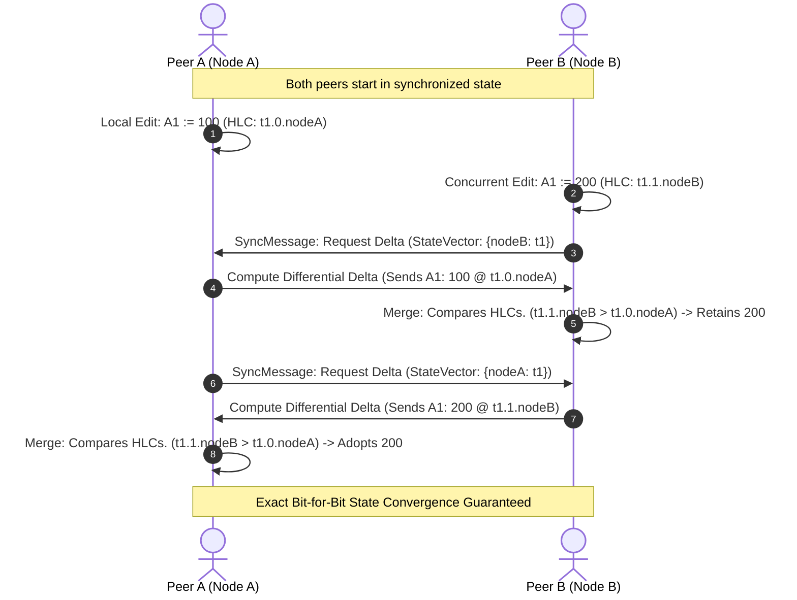

# Conflict-Free Replicated Data Types (CRDT) and State-Vector Replication

This monograph outlines the distributed consensus, Hybrid Logical Clock (HLC) mathematics, and differential state-vector synchronization protocols powering real-time multi-peer collaboration in Trellis.

## 1. Collaboration Model and Strong Eventual Consistency

Trellis provides real-time, peer-to-peer or server-mediated collaboration without central locking. The system guarantees Strong Eventual Consistency (SEC):
- Any two peers that have observed the exact same set of updates will always arrive at the exact same state, regardless of update delivery order, network latency, or transient disconnections.
- Network updates are commutative, associative, and idempotent.

## 2. Hybrid Logical Clocks (HLC)

Standard wall clocks (such as NTP timestamps) suffer from clock drift, leap seconds, and non-monotonic backward jumps. Lamport logical clocks solve causality but lose physical wall-clock correlation.

Trellis implements a **Hybrid Logical Clock (HLC)** as a 3-tuple:
$$HLC = (l, c, \text{nodeId})$$
where:
- $l \in \mathbb{N}$: Physical time component in milliseconds.
- $c \in \mathbb{N}$: Logical counter tracking events within the same physical millisecond.
- $\text{nodeId} \in \text{String}$: Unique peer identifier used to break simultaneous ties deterministically.

### 2.1 Monotonic Causality Rules
1. **Local Send / Edit Event**:
   $$l_{new} = \max(l_{old}, \text{currentTimeMillis}())$$
   $$c_{new} = \begin{cases} c_{old} + 1 & \text{if } l_{new} = l_{old} \\ 0 & \text{otherwise} \end{cases}$$

2. **Remote Message Receipt Event** from peer with $(l_{msg}, c_{msg})$:
   $$l_{new} = \max(l_{old}, l_{msg}, \text{currentTimeMillis}())$$
   $$c_{new} = \begin{cases} \max(c_{old}, c_{msg}) + 1 & \text{if } l_{new} = l_{old} = l_{msg} \\ c_{old} + 1 & \text{if } l_{new} = l_{old} \\ c_{msg} + 1 & \text{if } l_{new} = l_{msg} \\ 0 & \text{otherwise} \end{cases}$$

## 3. Last-Write-Wins (LWW) Cell Registers

Each cell coordinate `(sheet, row, col)` is governed by an independent `LWWRegister`:
- An update $U_1$ strictly dominates update $U_2$ if:
  $$(l_1 > l_2) \lor (l_1 = l_2 \land c_1 > c_2) \lor (l_1 = l_2 \land c_1 = c_2 \land \text{nodeId}_1 > \text{nodeId}_2)$$
- If a remote delta arrives with an HLC lower than the local register, it is discarded as an obsolete stale write.
- If the remote delta has a higher HLC, the local register is updated, and the reactive calculation engine schedules the cell for wave propagation.

## 4. State-Vector Synchronization Protocol

To minimize bandwidth consumption during replication:
1. Every peer maintains a `StateVector`: a mapping of `nodeId -> serialized HLC` tracking the highest known timestamp from every participating peer.
2. When two peers synchronize, peer $B$ transmits its `StateVector` to peer $A$.
3. Peer $A$ computes the minimal differential delta:
   $$\Delta_{A \to B} = \{ \text{reg} \in \text{Registers}_A \mid \text{reg}.HLC > \text{vector}_B[\text{reg}.HLC.\text{nodeId}] \}$$
4. Only the differential changes are serialized and transmitted over the wire, achieving $O(\Delta)$ network efficiency rather than $O(N)$ full-state snapshots.
