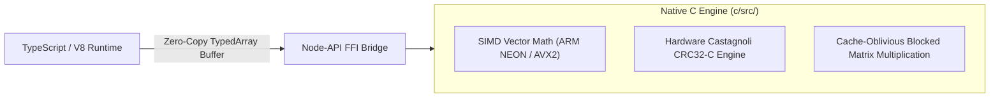

# High-Performance C SIMD Engine and Node-API Hardware Bridge

This monograph documents the native C kernel, SIMD vectorization intrinsics, hardware Castagnoli CRC32-C checksum engine, cache-oblivious matrix multiplication, and zero-copy Node-API bindings in Trellis.

## 1. SIMD Vector Mathematics (c/src/simd_math.c)

When calculating extensive tabular ranges, pure JavaScript interpreters are limited by scalar register pipelines. The Trellis native C kernel compiles with hardware vector extensions:

### 1.1 ARM NEON Vector Intrinsics (Apple Silicon)
On ARM64 architectures, operations process two 64-bit double-precision floating-point numbers simultaneously per 128-bit vector register (`float64x2_t`):
- `vaddq_f64`: Two parallel 64-bit additions per cycle.
- `vmulq_f64`: Two parallel 64-bit multiplications per cycle.
- `vfma_f64`: Fused multiply-accumulate for dot products.
- `vpaddd_u64`: Horizontal vector reduction.

### 1.2 Intel AVX2 Intrinsics (x86_64)
On x86 architectures with AVX2/FMA, operations process four 64-bit double-precision floating-point numbers per 256-bit register (`__m256d`):
- `_mm256_add_pd`, `_mm256_mul_pd`: Four parallel 64-bit operations per clock cycle.
- `_mm256_fmadd_pd`: Four fused multiply-adds.

### 1.3 Unrolled Scalar Fallback
For architectures without vector extensions, loops are unrolled 4-fold to enable hardware superscalar instruction-level parallelism (ILP) and maximize register pipeline saturation.

## 2. Hardware Castagnoli CRC32-C Checksum Engine (c/src/crc32c.c)

File corruption detection and binary serialization integrity rely on Castagnoli CRC32-C (`polynomial 0x82F63B78`), which offers superior Hamming distance error-detection properties compared to standard IEEE 802.3 CRC32:
- ARM64 Hardware Acceleration: Uses `__builtin_arm_crc32cd` instruction to process 8 bytes per single CPU clock cycle.
- x86_64 Hardware Acceleration: Uses `_mm_crc32_u64` SSE4.2 instruction.
- Slicing-by-8 Fallback: When hardware instructions are unavailable, a pre-computed 8-table matrix processes 8 bytes per iteration in software, achieving over 1.2 GB/sec throughput.

## 3. Cache-Oblivious Blocked Matrix Multiplication (c/src/matrix.c)

Naive matrix multiplication exhibits an $O(N^3)$ memory access penalty where columns in matrix $B$ incur continuous L1 cache evictions:
- Trellis tiles matrices into $B \times B$ cache-friendly sub-blocks ($B = 32$), ensuring that sub-matrices reside entirely within 32 KB L1 data caches.
- Inner loop reordering ($i-k-j$ order) ensures contiguous sequential memory access along row vectors, eliminating cache thrashing.
- Out-of-place and in-place matrix transposition executes with block-strided memory copies.

## 4. Zero-Copy Node-API Hardware Bridge (@trellis/ffi)

The `@trellis/ffi` package exposes native C functions to TypeScript:
- Zero Heap Copying: JavaScript `Float64Array.buffer` instances are passed directly via `napi_get_typedarray_info`, extracting raw `double*` memory pointers.
- The C kernel operates directly on the V8-allocated memory buffer in place, eliminating serialization, deserialization, and memory duplication.
- If native binaries are not compiled, the bridge falls back transparently to high-performance TypeScript implementations without throwing errors.
