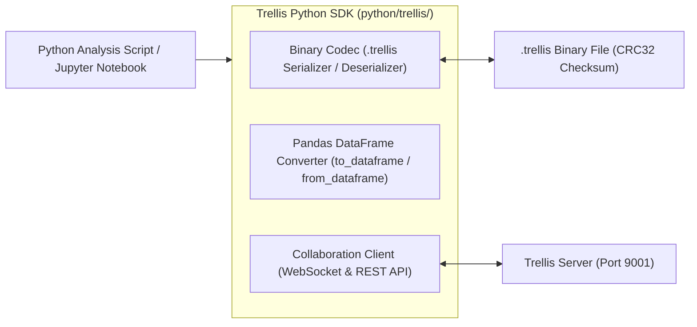

# Python SDK, Binary Codec, and Pandas DataFrame Interop

This monograph details the pure-Python `.trellis` binary codec, Pandas DataFrame bridge, and collaborative WebSocket client powering Python analysis in Trellis.



## 1. Pure-Python Binary .trellis Codec (python/trellis/codec.py)

Trellis bundles a zero-dependency binary serializer and parser implemented in pure Python using standard library `struct` and `zlib`:
- Header Specification: 4-byte magic signature `TRLS`, uint16 version `0x0001`, uint32 manifest length, UTF-8 manifest JSON containing workbook metadata and sheet hierarchies.
- Binary Cell Chunks: Cell coordinates, raw formulas, computed scalar types, and Castagnoli CRC32-C integrity verification.
- Bit-Exact Compatibility: Workbooks saved in TypeScript can be read in Python without conversion, and vice versa.

## 2. Pandas DataFrame Bidirectional Bridge (python/trellis/dataframe.py)

The `TrellisDataFrameBridge` provides seamless bidirectional integration with tabular Python data science workflows:

### 2.1 Reading Sheets into Pandas
```python
from trellis import TrellisWorkbook, to_dataframe

# Load a workbook from binary file
wb = TrellisWorkbook.load("financial_model.trellis")
sheet = wb.get_sheet("Revenues")

# Extract tabular range into a typed Pandas DataFrame
df = to_dataframe(sheet, "A1:E5000")
print(df.describe())
```
- Automatically identifies header rows.
- Infers numerical, categorical, boolean, and datetime dtypes matching Pandas conventions.
- Preserves missing values as `NaN` or `None`.

### 2.2 Writing DataFrames Back to Sheets
```python
from trellis import from_dataframe

# Transform or forecast in Python
df["Forecast_2026"] = df["Revenue_2025"] * 1.15

# Write back starting at coordinate F1
from_dataframe(df[["Forecast_2026"]], sheet, start_cell="F1")
wb.save("financial_model_updated.trellis")
```

## 3. Real-Time Collaboration Client (python/trellis/client.py)

The Python SDK includes a client connecting directly to Trellis collaboration servers:
- REST API Client: Evaluates formulas remotely via `client.evaluate_formula("=XNPV(0.08, A1:A10, B1:B10)")`, fetches session snapshots in JSON or CSV, and inspects server health.
- WebSocket State-Vector Sync: Streams real-time mutations and updates peer registers using Hybrid Logical Clocks, enabling automated Python background analytics agents to collaborate alongside interactive web users.
