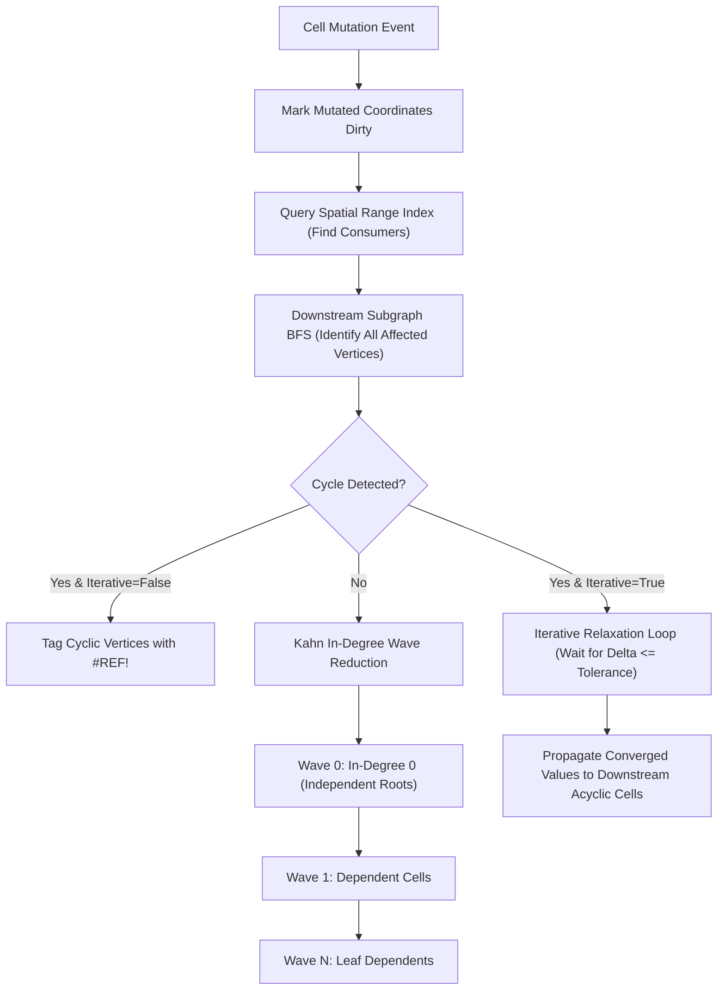

# Reactive Dependency DAG and Topological Wave Propagation

This monograph presents the formal mathematical foundations and implementation mechanics of the Trellis reactive calculation graph, spatial range index, Tarjan cycle detector, and topological wave scheduler.

## 1. Graph Formulation

Let the calculation graph be a directed graph $G = (V, E)$ where:
- $V$: The set of vertices representing spreadsheet coordinates `(sheet, row, col)`.
- $E \subseteq V \times V$: The set of directed dependency edges. An edge $(u, v) \in E$ indicates that vertex $v$ directly reads the value of vertex $u$. Vertex $u$ is a **precedent** of $v$, and $v$ is a **dependent** of $u$.

For every vertex $v \in V$:
$$\text{Precedents}(v) = \{ u \in V \mid (u, v) \in E \}$$
$$\text{Dependents}(u) = \{ v \in V \mid (u, v) \in E \}$$

## 2. Spatial Range Dependencies

In spreadsheet formulas, dependencies frequently span entire 2D ranges, such as `=SUM(A1:C100)`. Storing individual point-to-point edges for millions of cell pairs would yield unacceptable memory overhead and edge proliferation.

Trellis solves this via the **Spatial Range Index**:
- Range dependencies are registered as geometric rectangles $R = [r_{start}, r_{end}] \times [c_{start}, c_{end}]$ associated with consumer cell $v$.
- When a cell $u = (r, c)$ is mutated, the index executes a 2D bounding interval query in $O(\log N + K)$ time, identifying all consumer cells $v$ whose range footprints encompass coordinate $(r, c)$.
- The identified consumer nodes are automatically merged into the dirty calculation frontier.

## 3. Tarjan Strongly Connected Components (SCC) Cycle Detector

Circular references create infinite evaluation loops unless identified. Trellis runs Tarjan's SCC algorithm on the graph:
1. Vertices are visited via Depth-First Search (DFS), maintaining `index` and `lowlink` scalars.
2. If `lowlink[v] == index[v]`, an SCC is popped from the stack.
3. Any component containing $|SCC| > 1$ (or a self-loop $|SCC| = 1$ with an edge to itself) constitutes a circular reference.
4. If iterative calculation is disabled, all vertices in the component are tagged with `#REF!` errors, and wave scheduling skips them.

## 4. Kahn Topological Wave Scheduling

Given a set of mutated roots $R \subseteq V$:
1. **Transitive Dirty Closure**: A Breadth-First Search (BFS) traverses outgoing dependent edges and spatial queries, accumulating the affected dirty subgraph $V_{dirty} \subseteq V$.
2. **In-Degree Computation**: For every $v \in V_{dirty}$, calculate its induced in-degree:
   $$in\_degree(v) = |\{ u \in V_{dirty} \mid (u, v) \in E \}|$$
3. **Wave Partitioning**:
   - Initial wave $W_0 = \{ v \in V_{dirty} \mid in\_degree(v) = 0 \}$.
   - While $W_k$ is non-empty:
     - For each $u \in W_k$, decrement the in-degree of all dependents $v \in \text{Dependents}(u) \cap V_{dirty}$.
     - Any dependent whose in-degree reaches 0 enters wave $W_{k+1}$.
4. **Execution Invariant**: Every cell in wave $W_k$ is guaranteed to depend only on cells evaluated in waves $W_j$ where $j < k$, ensuring zero redundant re-evaluations.

## 5. Iterative Relaxation Resolver

In financial engineering and scientific simulations, circular references are frequently used intentionally to model equilibrium conditions (such as interest debt schedules).

When `workbook.calculationOptions.iterative` is enabled:
1. Cyclic components are isolated from the acyclic waves.
2. Non-cyclic upstream precedents are evaluated first.
3. The cyclic vertices are iterated in relaxation waves up to `maxIterations` (default 100):
   $$\Delta^{(t)} = \max_{v \in SCC} |v^{(t)} - v^{(t-1)}|$$
4. When $\Delta^{(t)} \le \text{tolerance}$ (default $10^{-6}$), the cycle has converged and iteration terminates.
5. Downstream acyclic dependents of the cyclic nodes are scheduled and evaluated in subsequent waves.
