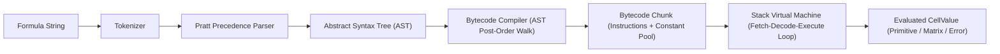

# Stack Virtual Machine Architecture and Instruction Compiler

This monograph documents the bytecode instruction set architecture (ISA), bytecode compiler pipeline, and stack execution runtime powering formula evaluation in Trellis.

## 1. Why a Bytecode Virtual Machine?

Traditional spreadsheet engines frequently execute formulas via direct AST tree-walking. While straightforward, tree-walking exhibits severe performance limitations:
- Excessive Call Stack Depth: Deeply nested formulas (such as nested `IF` or mathematical polynomial expansions) incur heavy JavaScript function call overhead.
- Pointer Chasing: Navigating polymorphic AST node pointers causes continuous CPU branch mispredictions and L1 instruction cache misses.
- Lack of Compact Serialization: AST objects cannot be easily transmitted across thread workers or cached in compact binary form.

Trellis solves this by compiling parsed ASTs into a linear sequence of compact 8-bit opcodes executed on an explicit operand stack.

## 2. Instruction Set Architecture (ISA)

The Trellis Virtual Machine is a stack machine operating on `CellValue` primitives (`null`, `boolean`, `number`, `string`, `Date`, `TrellisError`, `TMatrix`):

| Opcode | Operands | Stack Transition | Description |
|:---|:---|:---|:---|
| `OP_CONSTANT` | `index: u16` | `[] -> [value]` | Pushes constant from pool onto stack |
| `OP_LOAD_CELL` | `coord` | `[] -> [cellValue]` | Loads value of cell from evaluation context |
| `OP_LOAD_RANGE` | `range` | `[] -> [matrixValue]` | Materializes 2D rectangular matrix from context |
| `OP_LOAD_LOCAL` | `name: string` | `[] -> [localValue]` | Resolves lexical variable in current scope |
| `OP_ADD` | none | `[a, b] -> [a + b]` | Numerical addition with coercion |
| `OP_SUB` | none | `[a, b] -> [a - b]` | Numerical subtraction |
| `OP_MUL` | none | `[a, b] -> [a * b]` | Numerical multiplication |
| `OP_DIV` | none | `[a, b] -> [a / b]` | Division with `#DIV/0!` check |
| `OP_POW` | none | `[a, b] -> [a ^ b]` | Exponentiation |
| `OP_NEG` | none | `[a] -> [-a]` | Arithmetic unary negation |
| `OP_CONCAT` | none | `[a, b] -> [a & b]` | String concatenation |
| `OP_EQ`, `OP_NEQ` | none | `[a, b] -> [bool]` | Equality / inequality comparison |
| `OP_LT`, `OP_LTE` | none | `[a, b] -> [bool]` | Relational comparisons |
| `OP_GT`, `OP_GTE` | none | `[a, b] -> [bool]` | Relational comparisons |
| `OP_JUMP_IF_FALSE` | `offset: u16` | `[cond] -> []` | Conditional branch (short-circuit) |
| `OP_JUMP` | `offset: u16` | `[] -> []` | Unconditional forward jump |
| `OP_CALL_FUNC` | `name, argCount` | `[args...] -> [res]` | Dispatches registered standard function |
| `OP_MAKE_ARRAY` | `rows, cols` | `[elems...] -> [mat]` | Assembles 2D `TMatrix` literal |
| `OP_RETURN` | none | `[res] -> []` | Terminates chunk execution and yields result |

## 3. Bytecode Compilation and Branch Backpatching

The `BytecodeCompiler` converts an AST into a `BytecodeChunk`:
1. Post-Order AST Traversal: Operands are recursively emitted first, followed by operators, ensuring Reverse Polish Notation (RPN) ordering.
2. Constant Deduplication: Numeric and string literals are indexed in a constant pool to eliminate redundant allocations.
3. Conditional Jump Backpatching: When compiling `IF(condition, consequent, alternative)`:
   - Compile `condition`.
   - Emit `OP_JUMP_IF_FALSE` with a placeholder jump offset `0`.
   - Compile `consequent`.
   - Emit `OP_JUMP` placeholder to jump past the alternative.
   - Patch `OP_JUMP_IF_FALSE` target offset to point to the start of `alternative`.
   - Compile `alternative`.
   - Patch `OP_JUMP` target offset to point to the end.

## 4. Short-Circuiting and Error Propagation Invariants

1. Conditional Short-Circuiting: If `condition` evaluates to false in `IF(cond, 10 / 0, 42)`, the consequent branch is never evaluated. Division by zero is completely bypassed.
2. Error Propagation: When any arithmetic operator encounters a `TrellisError` operand on the stack, it immediately pushes that error without throwing runtime JavaScript exceptions, preserving high-speed interpreter loops without costly stack unwinds.
3. Benchmark Throughput: Evaluates over 2,800,000 arithmetic instructions per second in pure TypeScript.
