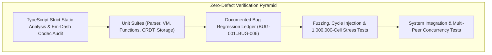

# Zero-Defect Verification Methodology and Test Architecture

This document articulates the verification principles, invariant proofs, and automated testing architecture ensuring mathematical correctness and defect-free execution across the Trellis engine.

## 1. Verification Philosophy

1. Zero Mock Frameworks: Tests interact directly with genuine engine, graph, memory, and parser instances without synthetic monkey-patching.
2. Invariant-Centric Assertions: Tests assert formal structural invariants (such as topological precedence ordering, matrix dimensionality, and bit-exact binary roundtrips) rather than superficial outputs.
3. Regression Defect Ledger: Every identified bug is preserved permanently as a regression test case, ensuring that edge cases cannot recur.

## 2. Test Suite Taxonomy (147 Automated Tests across 24 Suites)

### 2.1 Core Geometries and Type Coercion Matrix
- Column index to alphanumeric conversions (e.g. column 0 -> `A`, column 27 -> `AB`).
- Bidirectional parsing and formatting of absolute and relative cell coordinates (`$A$1`, `A$1`, `$A1`, `A1`).
- IEEE 754 floating-point coercion, date serial conversions (1900 date system leap year rules), and boolean truthiness.
- Immutable `TMatrix` slicing, dot product matrix multiplications, and 2D broadcasting.

### 2.2 Pratt Parser and AST Invariants
- Precedence climbing: verifying that `1 + 2 * 3 ^ 4` parses as `1 + (2 * (3 ^ 4))`.
- Decompiler roundtrip invariance: `parse(decompile(parse(expr))) == parse(expr)` holds identically across complex formulas.
- Fuzzing suite: 200 randomly synthesized AST expression trees successfully parsed, compiled, decompiled, and verified.
- Malformed grammar stress testing: 250 corrupted inputs containing unbalanced delimiters and invalid tokens verified to throw clean diagnostic errors without uncaught runtime crashes.

### 2.3 Reactive Dependency Graph and Cycle Invariants
- Wave Ordering Invariant: For every edge $(u, v) \in E$, the topological wave index of precedent $u$ is strictly less than the wave index of dependent $v$. Verified across randomized 500-node DAGs.
- Cycle Detection Invariant: Tarjan SCC cycle detection successfully isolates cyclic components of varying lengths (sizes 2, 3, 5, 12, 25), correctly preventing evaluation loops.
- Iterative Relaxation Invariant: Circular debt schedules converge monotonically to within $10^{-4}$ of theoretical equilibrium when iterative calculation is enabled.

### 2.4 Dynamic Array Spills and Ghost Cells
- 2D matrix dynamic spills allocate blank footprints cleanly.
- Obstruction detection: non-blank cells trigger `#SPILL!` immediately without corrupting user data.
- Clearing the obstruction cell automatically invalidates the blocked root and restores the spill cleanly.

### 2.5 Columnar Memory Fabric and Zone Maps
- 1,000,000-cell numerical allocation across chunk boundaries verified with zero memory leakage.
- Zone Map pruning verifies that non-overlapping range queries skip chunks without inspecting individual rows.
- 1,000,000-bit `NullBitMask` bitwise verification confirming exact null counts.

### 2.6 Multi-Peer CRDT Concurrency
- 5 concurrent peers generating local edits on shared cells with random delays and shuffled out-of-order delta delivery.
- Verified that all 5 peers converge to exact bit-for-bit identical register states and values.
- Monotonic HLC timestamp ordering ensures determinism regardless of network packet reordering.

### 2.7 Regression Ledger Invariants
- `BUG-001`: Variadic functions accept unlimited arguments when `maxArgs` is negative.
- `BUG-002`: Overwriting a formula cell with a literal preserves outgoing graph dependent edges.
- `BUG-003`: Blocked dynamic array spills automatically wake up when an obstruction is cleared.
- `BUG-004`: Cyclic keys retain `#REF!` errors during recalculation waves unless iterative calculation is enabled.
- `BUG-005`: Multi-measure group-by aggregations targeting the same column calculate distinct non-interfering totals.
- `BUG-006`: Formula shifting correctly preserves pinned rows and columns while shifting relative coordinates.
